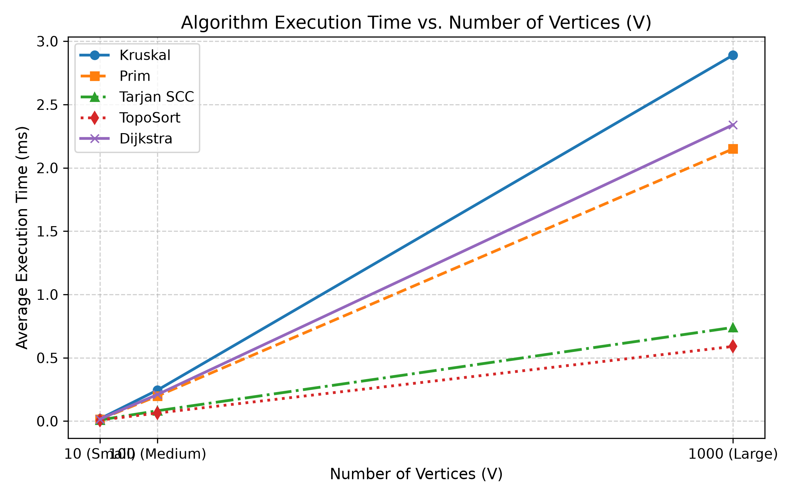
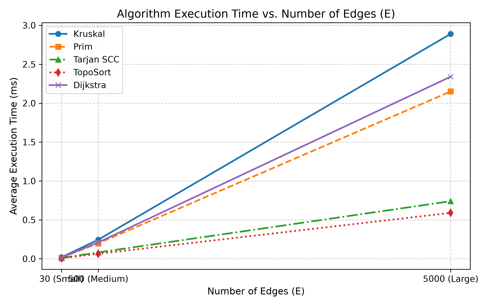

# Assignment 3: Smart City Infrastructure and Route Planning

## Overview
This project models a city's road and service network as a weighted graph $G = (V, E)$, where vertices represent city districts and edges represent roads or infrastructure connections. Depending on the problem, edge weights represent either construction costs or travel distances. Both undirected and directed graphs are supported using an adjacency list representation.

## Implementation
- **Graph (`graph`):** Stores an adjacency list (`List<List<Edge>>`) and an edge list (`List<Edge>`). Undirected graphs insert edges in both directions for $O(\text{deg}(u))$ neighbor lookups while keeping a single copy in the edge list for Kruskal's algorithm.
- **Disjoint Set Union (`dsu`):** Implements `find` with path compression and `union` by rank to track connected components efficiently.
- **Minimum Spanning Tree (`mst`):**
    - `KruskalMST`: Sorts all edges by weight and merges disjoint sets until $V - 1$ edges are added.
    - `PrimMST`: Grows a single tree starting from vertex `0` using a binary heap (`PriorityQueue`) to select the lightest outgoing edge.
- **Connectivity (`connectivity`):**
    - `TopologicalSort`: Uses Kahn's in-degree BFS algorithm. If fewer than $V$ vertices are processed, the graph has a cycle.
    - `TarjanSCC`: Finds strongly connected components in a single DFS pass using discovery times and low-link values.
- **Shortest Paths (`shortestpath`):**
    - `DijkstraSP`: Uses a priority queue to relax non-negative outgoing edges from a source district and reconstructs paths via a `parent` array.
    - *Why Dijkstra fails with negative weights:* Dijkstra assumes that once a vertex with the smallest tentative distance is popped from the priority queue, its shortest path is permanently fixed. With negative edge weights, a longer path found later can be reduced by a negative edge to become shorter than a previously finalized distance, breaking the greedy assumption.

## Complexity Analysis
All analyses assume an adjacency list representation and a binary heap priority queue.

| Algorithm | Time Complexity | Space Complexity | Notes |
| :--- | :--- | :--- | :--- |
| **DSU (`find` / `union`)** | $O(\alpha(V))$ amortized | $O(V)$ | Path compression and union by rank keep tree heights nearly flat. |
| **Kruskal's MST** | $O(E \log E)$ | $O(V + E)$ | Dominated by sorting the edge list; DSU operations take $O(E \alpha(V))$. |
| **Prim's MST** | $O(E \log V)$ | $O(V + E)$ | Up to $E$ edges are pushed to the priority queue, each taking $O(\log V)$. |
| **Topological Sort** | $O(V + E)$ | $O(V)$ | Every vertex and directed edge is processed a constant number of times. |
| **Tarjan's SCC** | $O(V + E)$ | $O(V)$ | Single DFS traversal visiting each vertex and edge once. |
| **Dijkstra's Algorithm** | $O((V + E) \log V)$ | $O(V)$ | Priority queue extractions and edge relaxations scale logarithmically with $V$. |

## Experimental Setup
Three graph configurations were tested using a fixed seed (`42L`) for reproducibility:
- **Small:** $V = 10, E = 30$
- **Medium:** $V = 100, E = 500$
- **Large:** $V = 1000, E = 5000$

Connected undirected graphs are created by first generating a random spanning tree of $V - 1$ edges and then adding random unique edges until $E$ edges are reached. Directed graphs are generated in two forms: unrestricted directed graphs (which naturally contain cycles at these densities) and strict DAGs (enforced by orienting edges from lower-indexed to higher-indexed vertices, $u < v$). Each test was repeated 5 times, and execution times were recorded with `System.nanoTime()`.

## Results

| Graph  |  V   |  E   | Algorithm  | Avg Time (ns) | Avg Ops |
|:-------|:----:|:----:|:-----------|:-------------:|:-------:|
| Small  |  10  |  30  | Kruskal    |     32016     |   179   |
| Small  |  10  |  30  | Prim       |     46966     |   218   |
| Small  |  10  |  30  | Tarjan SCC |     74091     |   60    |
| Small  |  10  |  30  | TopoSort   |     23991     |   80    |
| Small  |  10  |  30  | Dijkstra   |     22624     |   75    |
| Medium | 100  | 500  | Kruskal    |    367741     |  4735   |
| Medium | 100  | 500  | Prim       |    237758     |  4908   |
| Medium | 100  | 500  | Tarjan SCC |     98750     |   800   |
| Medium | 100  | 500  | TopoSort   |    107958     |  1200   |
| Medium | 100  | 500  | Dijkstra   |    135858     |  2200   |
| Large  | 1000 | 5000 | Kruskal    |    1663833    |  70014  |
| Large  | 1000 | 5000 | Prim       |    2340891    |  98541  |
| Large  | 1000 | 5000 | Tarjan SCC |    458425     |  8000   |
| Large  | 1000 | 5000 | TopoSort   |    1121933    |  12000  |
| Large  | 1000 | 5000 | Dijkstra   |    1524933    |  29940  |

### Plots

## Comparison and Discussion
- **Kruskal vs. Prim:** Both algorithms returned identical MST weights across all connected graphs. Prim's algorithm ran faster and performed fewer comparisons on Medium and Large graphs because Kruskal sorts all $E$ edges upfront, while Prim skips edges that lead to already-visited vertices.
- **DSU Performance:** Path compression and union by rank kept `find` and `union` operation counts proportional to $E$, avoiding deep tree traversals as $V$ increased to $1000$.
- **SCC and Topological Sort:** Both algorithms scaled linearly with $V + E$. Increasing the graph size by $10\times$ from Medium to Large resulted in roughly a $10\times$ increase in operations and runtime.
- **Dijkstra:** Runtime and operation counts grew slightly faster than linear due to heap insertions and extractions, matching the expected $O((V + E) \log V)$ complexity.

## Testing
Correctness checks in `MainBenchmark.runTests()` verify:
- Single-vertex graphs ($V = 1$) are recognized as connected with an MST weight of `0`.
- Disconnected graphs are properly flagged with `isConnected = false`.
- Graphs with duplicate edge weights and multiple valid MSTs return identical total weights in both Kruskal's and Prim's algorithms.
- Cyclic directed graphs are rejected by `TopologicalSort` (`hasCycle = true`), while DAGs produce a valid topological ordering.
- Tarjan's SCC assigns every vertex to exactly one strongly connected component.
- Unreachable vertices in `DijkstraSP` retain a distance of `Double.POSITIVE_INFINITY` and return an empty path.

## Conclusion
For infrastructure planning, Prim's algorithm is generally faster on connected graphs represented as adjacency lists, while Kruskal's algorithm is convenient when working directly with edge lists. Tarjan's SCC and Kahn's Topological Sort provide fast linear-time analysis for one-way road networks and service dependencies, and Dijkstra's algorithm efficiently computes shortest paths when all edge weights are non-negative.